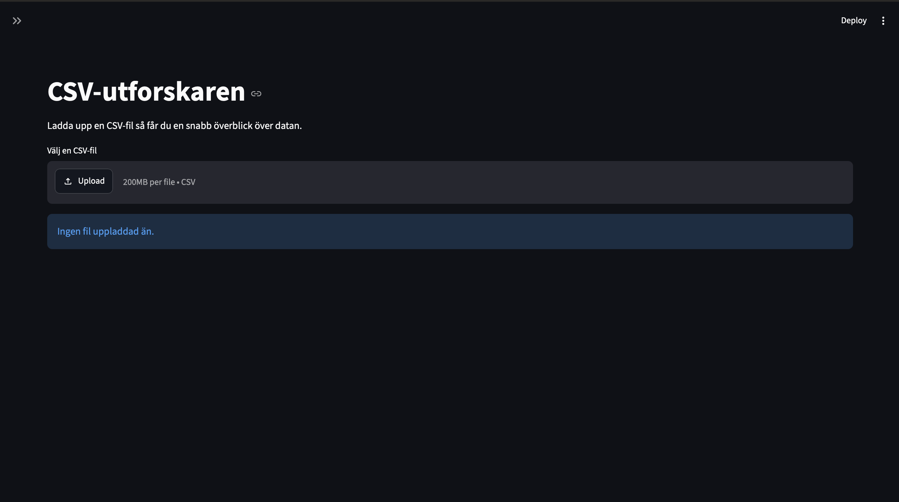
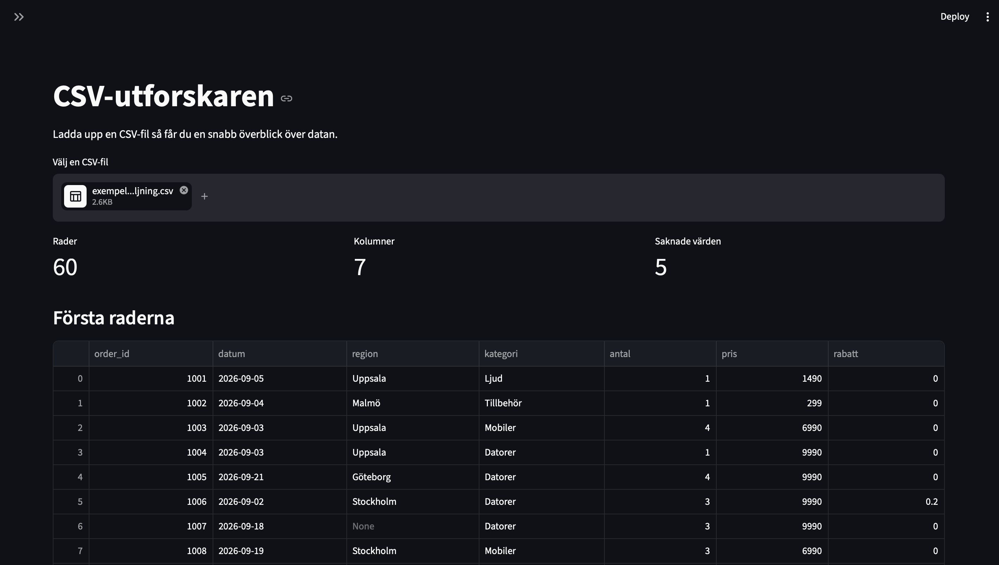
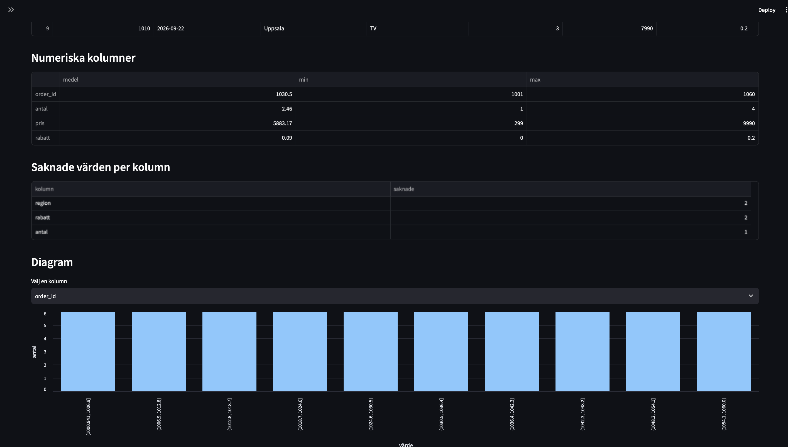
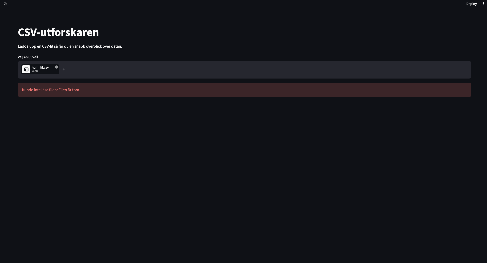

# Fördjupning i Python: Streamlit filläsare app

**Namn:** Azar Mohseni
**Kurs:** Fördjupning i Pythonprogrammering
**Projekt:** CSV-utforskaren, en Streamlit-app

---

## Syfte

Jag ville lära mig grunderna i Streamlit och förstå hur ett Streamlit-program faktiskt fungerar. Målet var att bygga en liten app där man kan ladda upp en CSV-fil och direkt få en överblick över datan.

Det var tre saker jag särskilt ville förstå:

1. Hur Streamlit kör programmet.
2. Varför man använder cache och hur `st.cache_data` fungerar.
3. Hur man kan dela upp koden så att logiken går att testa, fast den används i en app.

## Området och dess relevans

Streamlit är ett Pythonbibliotek som man använder för att bygga webbappar för data. Fördelen är att man behöver bara Python.

Som Data Scientist behöver man ofta visa sina resultat för folk som inte programmerar till exempel kollegor eller en chef. En notebook är inte så lätt för dem att använda. Med Streamlit kan man ganska snabbt göra en app där de själva kan ladda upp data, välja kolumner och kolla på diagram. Därför tycker jag det passar bra för prototyper, interna verktyg och enkla dashboards.

## Viktiga begrepp

**Rerun.** Det här är nog det viktigaste jag lärde mig. Streamlit kör hela `app.py` från början till slut varje gång användaren gör något, till exempel laddar upp en fil eller väljer något i en meny. Det finns alltså inga vanliga knappfunktioner som i andra program. Det gör koden enkel att skriva men det betyder också att allt räknas om varje gång om man inte gör något åt det.

**Widgets.** Det är saker som användaren kan klicka på eller använda, till exempel `st.file_uploader` och `st.selectbox`. En widget ger tillbaka sitt värde direkt i koden. Om jag skriver `column = st.selectbox(...)` så får jag den kolumn som användaren har valt just nu.

**st.cache_data.** En dekorator som sparar resultatet av en funktion. Om funktionen körs igen med samma indata så hämtas resultatet från cachen istället för att räknas om. Streamlit kollar om indatan är samma genom att göra en hash av argumenten. Därför skickar jag in filens innehåll som `bytes`, eftersom Streamlit kan hasha det. Laddar man upp en ny fil blir hashen annorlunda och då läses filen in på nytt.

**st.session_state.** Eftersom hela skriptet körs om så glömmer vanliga variabler sina värden. `st.session_state` fungerar som ett minne som finns kvar mellan körningarna, så länge sidan är öppen.

**st.stop.** Den stoppar skriptet. Jag använder den när ingen fil är uppladdad eller när filen är fel, så att resten av koden inte körs.

## Genomförande

**Verktyg:** Python, Streamlit, pandas och pytest.

**Data:** Jag gjorde en egen påhittad CSV-fil med försäljningsdata. Den har 60 rader och kolumner som region, kategori, antal, pris och rabatt. Jag lade in några saknade värden med flit så att jag kunde se att appen hittar dem. Jag gjorde också en helt tom fil för att testa felhanteringen. Appen funkar med vilken CSV-fil som helst.

**Hur jag jobbade:** Jag följde metoden från kursvideon om hur man lär sig ett nytt bibliotek. Jag började med Streamlits officiella dokumentation, Get started och Main concepts. Sen testade jag små exempel och byggde appen steg för steg.

**Uppbyggnad.** Jag delade upp koden i två delar:

- I mappen `csv_explorer/` ligger logiken. `loading.py` läser in filen och `summary.py` gör beräkningarna. Den här koden använder inte Streamlit alls.
- `app.py` innehåller bara det som syns i appen.

Den här uppdelningen var ett viktigt val för mig. Om alla beräkningar hade legat direkt i `app.py` hade de varit svåra att testa, för då måste man starta hela appen. Nu kan jag testa logiken med vanlig pytest.

Jag använde också en dataclass som heter `DatasetInfo`. Den samlar antal rader, kolumner, numeriska kolumner och saknade värden i ett objekt.

**Felhantering.** Funktionen `read_csv_bytes` fångar de fel som pandas kan ge, alltså tom fil, fil som inte går att läsa och fel teckenkodning. Den gör om dem till ett `ValueError` med ett meddelande på svenska som är lätt att förstå. I appen fångas felet och visas med `st.error`, så användaren ser vad som hände istället för att appen kraschar.

**Problem jag stötte på:**

- *Allt räknades om vid varje klick.* Först fattade jag inte varför filen lästes in igen när jag bara bytte kolumn i menyn. Det var rerun som gjorde det. Lösningen blev `st.cache_data`.
- *Diagram för siffror.* Ett stapeldiagram med alla olika priser blev helt oläsligt. Därför delade jag in värdena i intervall med `pd.cut` och räknade hur många som hamnar i varje. För textkolumner visas de tio vanligaste värdena.
- *Testa appen.* Testerna hittade först inte `app.py` eftersom sökvägen räknas från mappen där testfilen ligger. Det löste jag med `pathlib`.

## Resultat

Appen gör det jag ville. När man laddar upp en fil visas:

- tre nyckeltal, rader, kolumner och saknade värden
- de första tio raderna
- en tabell med medelvärde, min och max för numeriska kolumner
- en tabell med saknade värden per kolumn
- ett stapeldiagram för den kolumn man väljer

Med min exempelfil visar appen 60 rader, 7 kolumner och 5 saknade värden. Två saknas i region, två i rabatt och ett i antal. Om man laddar upp den tomma filen kommer meddelandet Kunde inte läsa filen: Filen är tom.

I sidomenyn har jag en räknare som visar hur många gånger skriptet har körts. Den ökar varje gång man klickar på något, och på så sätt kan man se rerun med egna ögon.

**Tester:** Projektet har 13 tester och alla går igenom. De testar inläsningen, även med tom fil, sammanfattningarna, datan till diagrammet, att originaldatan inte ändras och själva appen med Streamlits testverktyg `AppTest`.

## Begränsningar och möjliga förbättringar

- Appen läser bara CSV-filer, inte Excel eller andra format.
- Den utgår från att filen har komma som avgränsare. Svenska CSV-filer från Excel har ofta semikolon och då visas allt som en enda kolumn.
- Hela filen läses in i minnet, så väldigt stora filer kan bli långsamma.
- Appen körs bara lokalt på datorn. Den är inte publicerad och har ingen inloggning.
- Sammanfattningen är ganska enkel. Den visar till exempel inga korrelationer eller samband mellan kolumner.

Saker jag skulle kunna förbättra är att låta användaren välja avgränsare, lägga till stöd för Excel och fler typer av diagram.

**När passar Streamlit och när passar det inte?** Jag tycker Streamlit passar bra för små appar, prototyper och interna verktyg när man snabbt vill visa data. Det passar sämre för stora appar med många användare eller avancerad design. Det beror på att hela skriptet körs om vid varje klick och att man inte kan styra utseendet så mycket.

## Koppling till yrkesrollen

En Data Scientist eller dataanalytiker kan använda Streamlit för att:

- dela en analys med kollegor som inte kan Python
- bygga ett internt verktyg där andra själva kan kolla på data
- visa en modell där man matar in värden och får en prediktion
- snabbt göra en prototyp innan man bygger något större

Min app är ett exempel på ett sånt verktyg. En kollega kan ladda upp en fil och snabbt se om datan har saknade värden innan man börjar med en analys.

## Källor

- Streamlit Documentation, Get started och Main concepts: https://docs.streamlit.io/get-started
- Streamlit Documentation, Caching overview: https://docs.streamlit.io/develop/concepts/architecture/caching
- Streamlit Documentation, Session State: https://docs.streamlit.io/develop/concepts/architecture/session-state
- Streamlit Documentation, App testing: https://docs.streamlit.io/develop/concepts/app-testing
- pandas Documentation: https://pandas.pydata.org/docs/
- Kursmaterial: Fördjupning i Python video 5 till 8 om pytest, testa datakod och felhantering, och video 11 om hur man lär sig ett nytt bibliotek.

## Självreflektion

**1. Vad lärde jag mig som jag inte kunde innan?**
Jag lärde mig hur Streamlit fungerar, att hela skriptet körs om vid varje klick och hur man använder cache och session state för att hantera det. Jag lärde mig också att hålla isär logiken och det som syns i appen, så att koden går att testa.

**2. Vad var svårast?**
Att förstå rerun. Det är ganska annorlunda mot vanliga program där koden bara körs en gång. Räknaren i sidomenyn hjälpte mig mycket att se vad som händer.

**3. Vilket tekniskt val är jag mest nöjd med?**
Att jag delade upp koden i `csv_explorer/` och `app.py`. Tack vare det kunde jag skriva tester för beräkningarna utan att starta appen.

**4. Vad hade jag gjort annorlunda?**
Jag hade läst om rerun och cache i dokumentationen direkt från början, istället för att först sitta och undra varför appen var seg.

**5. Vad är nästa steg?**
Att låta användaren välja avgränsare och lägga till stöd för Excel. Efter det skulle man kunna publicera appen på Streamlit Community Cloud.

**6. Vilket betyg tycker jag att arbetet motsvarar?**
G.

**7. Motivering.**
Jag har valt ett avgränsat område som är relevant för Data Science, lärt mig det med hjälp av den officiella dokumentationen och byggt en app som fungerar. Koden är uppdelad på ett tydligt sätt, det finns en README och det finns tester. Jag kan förklara hur appen fungerar och de viktigaste begreppen, så jag tycker att det motsvarar kraven för G. För VG hade jag behövt resonera djupare om alternativ, till exempel jämföra Streamlit med Dash, och visa att jag förstår mer om hur Streamlit funkar på insidan.